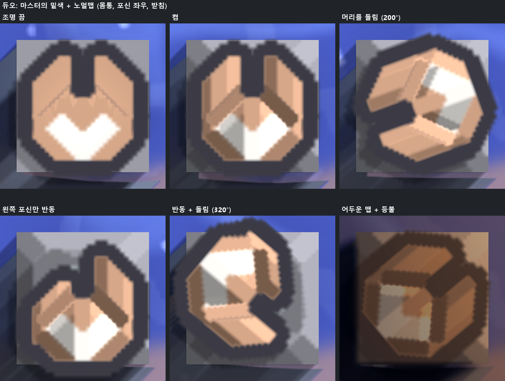
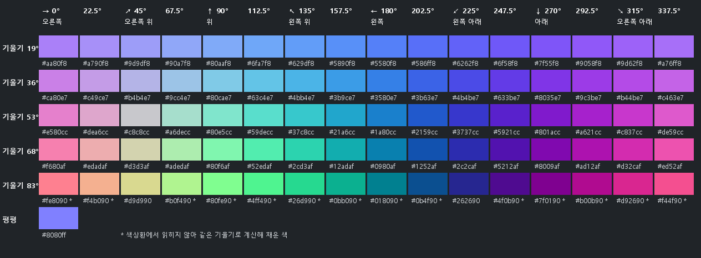

# Mindustry Shaders

Mindustry에 화면 효과만 더하는 Java 모드입니다. 콘텐츠는 추가하지 않고, 모든 효과는 **설정 → 셰이더**에서 하나씩 끌 수 있습니다.

A visual-effects-only Java mod for Mindustry: water, reflections, directional shadows, lights stopped by blocks, and hand-drawn normal maps for blocks. Adds no content; every effect has a switch under Settings → Shaders. Tested on v160.7 only.

| 모두 끔 | 모두 켬 |
|---|---|
|  |  |

> 아직 만드는 중입니다. 공식 **v160.7**에서만 시험했고, 그래픽 카드 한 종류에서만 돌려 봤습니다.

## 설치

게임 안에서 바로 받기: **모드 → 모드 가져오기 → GitHub에서 모드 가져오기**에 `redeagle0705/Shinny-Dustry`를 넣고 게임을 다시 시작합니다.

파일로 받기:

1. 이 저장소의 **Releases**에서 `mshaders.jar`를 받습니다.
2. 게임에서 **모드 → 모드 가져오기 → 파일 가져오기**로 그 파일을 고릅니다.
3. 게임을 다시 시작합니다.

물·얼음·바닥 효과는 게임의 **설정 → 그래픽 → 액체 애니메이션 효과**가 켜져 있어야 보입니다.

## 효과

| 효과 | 내용 |
|---|---|
| 물 | 굴절, 반짝임, 물가 거품 |
| 물 반사 | 물 위쪽에 있는 건물·유닛·불빛이 물에 비침 |
| 얼음 | 반사, 속 균열, 시점에 따라 미끄러지는 광택 |
| 바닥 | 암석 균열, 모래 바람결, 눈·소금 반짝임, 풀 바람, 뜨거운 바위, 금속 바닥 광택, 입체감 |
| 방향 그림자 | 블록 그림자가 해 반대쪽으로 뻗고, 시간에 따라 길어졌다 짧아짐 |
| 블록에 가려지는 빛 | 조명·총알·유닛의 빛이 블록 뒤로 넘어가지 않음. 어두운 맵에서는 게임 조명 자체가 그렇게 그려짐 |
| 공중 유닛 불빛 높이 | 날고 있는 유닛의 불빛은 위에서 떨어지는 것처럼 계산(짧은 그림자, 넓고 고른 빛) |
| 금속 반짝임 | 빛 쪽으로 기운 면의 하이라이트, 지나가는 햇빛 띠 |
| 노멀맵 조명 | 노멀맵이 있는 블록은 그려진 명암 대신 해와 주변 광원으로 계산한 명암을 받음 |
| 화면 색 보정 | 비네트, 채도, 대비, 색온도 |

공중 유닛 불빛 높이 — 끔 / 100% / 200% / 300%:


## 노멀맵 블록

블록마다 **명암 없는 밑색 그림**과 **노멀맵**을 한 쌍씩 손으로 그려 넣는 방식입니다. 그림이 있는 블록만 계산된 명암을 받고, 나머지는 게임 원래 그림 그대로입니다. 지금 들어 있는 것: 구리벽(1칸·2칸), 기계식 드릴, 실리콘 제련소, 분배기·정렬기·교차기·라우터 등 분배 블록, 다리·위상 컨베이어, 매스 드라이버, 듀오. 컨베이어는 높이맵으로 들어 있습니다.

듀오(몸통, 포신 좌우, 받침):



매스 드라이버(받침 + 돌아가는 머리):


### 직접 그려 넣기

그림 이름은 게임의 스프라이트 이름과 같습니다.

| 종류 | 넣는 곳 | 형식 |
|---|---|---|
| 밑색 | `mod/assets/sprites-override/…/<스프라이트>.png` | 명암과 테두리 없이. 테두리는 게임과 같은 규칙으로 모드가 붙임 |
| 노멀맵 | `mod/assets/normals/<스프라이트>.png` | 빨강 = 오른쪽, 초록 = 위, 파랑 = 보는 쪽. 평평한 면은 (128, 128, 255) |
| 높이맵 | `mod/assets/heightmaps/<스프라이트>.png` | 밝을수록 높음. 기울기는 모드가 계산 |

- 모드를 다시 빌드하지 않고 시험하려면 게임 데이터 폴더의 `mshaders-normals/`, `mshaders-heightmaps/`에 넣으면 됩니다(이쪽을 먼저 읽습니다).
- 드릴은 `<이름>-rotator`, `<이름>-top`도 읽습니다.
- 포탑과 매스 드라이버는 받침과 머리를 따로 읽습니다. 머리는 블록 이름, 받침은 게임이 쓰는 받침 스프라이트 이름입니다(포탑은 대개 크기별 공용 `block-1` … `block-4`).
- 움직이는 부품이 있는 포탑은 부품 스프라이트마다 읽습니다(예: `duo-barrel-l`).
- 색을 고를 때 쓰는 팔레트: [`heightmaps/palette`](heightmaps/palette) (16방향 × 기울기 5단계 + 평면).



## 빌드

Gradle 없이 JDK 17만으로 빌드합니다. `tools/build.ps1` 맨 위의 두 경로(JDK, 공식 `Mindustry.jar`)를 자기 컴퓨터에 맞게 고친 뒤:

```powershell
powershell -ExecutionPolicy Bypass -File tools\build.ps1
```

`build\mshaders.jar`가 나옵니다. `tools\run-test.ps1`은 게임을 별도 데이터 폴더(`profile\`)로 띄워 스크린샷을 찍는 시험 도구이고, `tools\deploy.ps1`은 만든 사람의 컴퓨터 경로가 적힌 개인용 스크립트입니다.

| 폴더 | 내용 |
|---|---|
| `mod.hjson` | 모드 정보(이름, 만든이, 버전). 게임의 모드 브라우저 목록이 저장소 맨 위에서 찾기 때문에 여기에 둠 |
| `mod/` | 모드 본체: `src/`(Java), `assets/`(셰이더, 그림, 번역) |
| `testkit/` | 시험 화면을 차리고 스크린샷을 찍는 도우미 모드(시험용) |
| `tools/` | 빌드·시험 스크립트, 높이맵·팔레트 생성 도구 |
| `heightmaps/` | 게임에서 꺼낸 스프라이트(그릴 때 기준), 팔레트, 초안들 |
| `docs/` | [작업 기록](docs/worklog-ko.md): 실험한 것, 측정값, 한계 |

## 알려진 한계

- 노멀맵이 없는 블록은 게임 원래 그림 그대로라, 그림이 있는 블록과 화풍이 섞여 보입니다.
- 게임의 **픽셀화** 설정을 켜면 물 반사·빛·반짝임·색 보정은 쉽니다.
- 에르키르 쪽 블록과 포탑은 거의 확인하지 않았습니다.
- 자세한 것은 [작업 기록](docs/worklog-ko.md)의 각 절 끝 "한계 / 미확인"에 있습니다.

## 라이선스

GPL-3.0. Mindustry(GPL-3.0, Anuken)의 코드에 맞춰 컴파일하고, `mod/assets/sprites-override/blocks/turrets/` 아래에는 게임 원본 스프라이트가 들어 있습니다.
