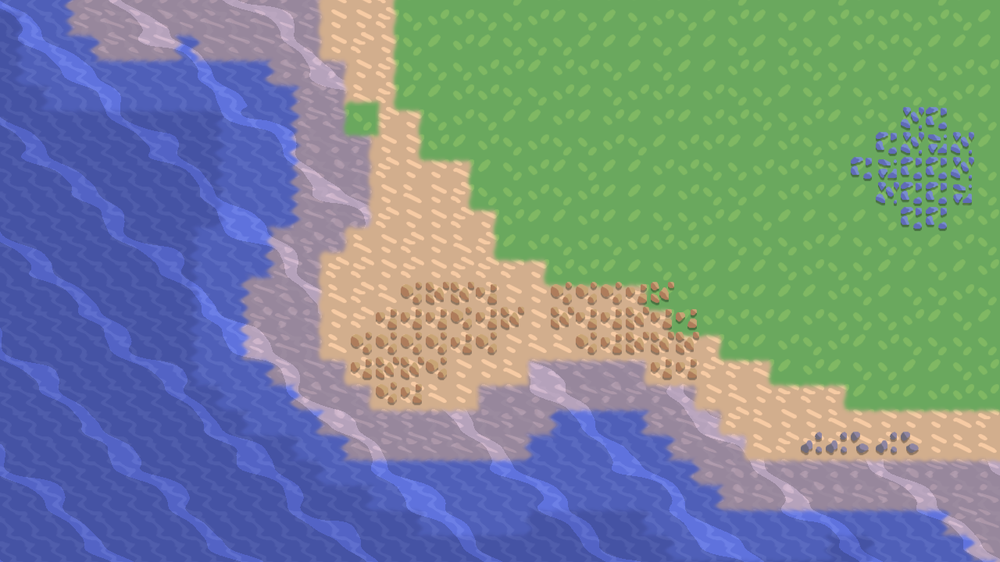
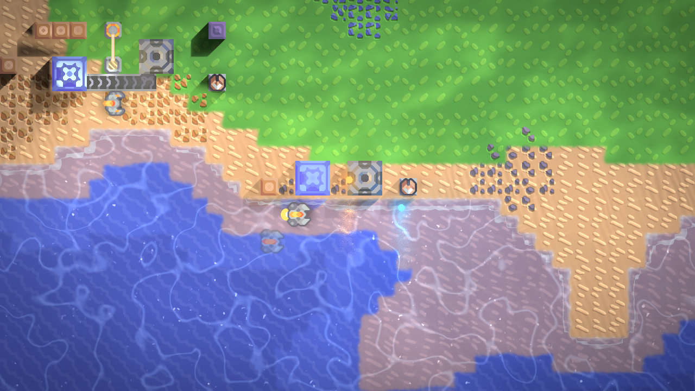
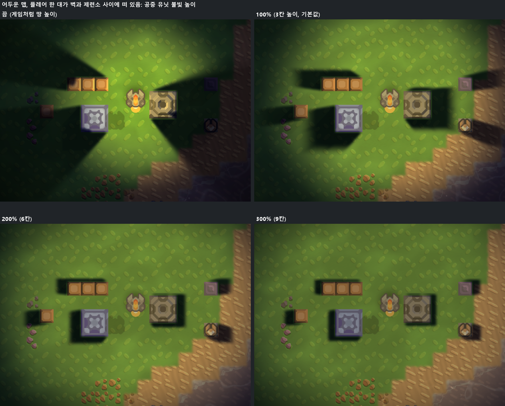
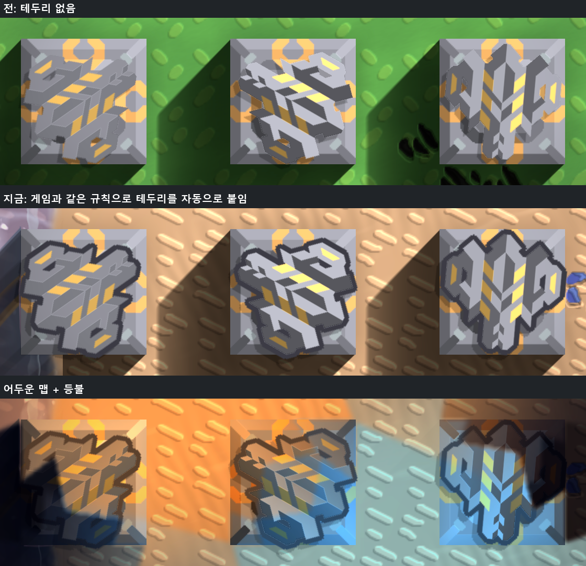

# Mindustry Shaders

Mindustry에 화면 효과만 더하는 Java 모드입니다. 콘텐츠는 추가하지 않고, 모든 효과는 **설정 → 셰이더**에서 하나씩 끌 수 있습니다.

A visual-effects-only Java mod for Mindustry: water, reflections, directional shadows, lights stopped by blocks, and hand-drawn normal maps for blocks. Adds no content; every effect has a switch under Settings → Shaders. Desktop and Android (not iOS). Tested on v160.7 only.

| 모두 끔 | 모두 켬 |
|---|---|
|  |  |

> 아직 만드는 중입니다. 공식 **v160.7**에서만 시험했고, 그래픽 카드 한 종류에서만 돌려 봤습니다.
>
> **PC와 안드로이드용입니다. iOS에서는 설치되지 않습니다**(게임이 iOS에서 Java 모드를 받지 않음). 안드로이드는 0.1.1부터 되고, 폰 한 대에서만 확인했습니다(색 조명과 노멀맵 블록이 있는 화면에서 60~120fps). 최신 안드로이드 가운데에는 Java 모드 불러오기 자체를 막는 기기가 있습니다. 0.1.4는 같은 폰에서 다시 확인했습니다(FHD+, 모든 설정을 켠 아주 큰 맵에서 60fps). 0.1.5~0.1.7은 폰의 큰 기지에서 매우 느렸습니다(6~25fps): 모드가 그림을 가져오면 게임이 그림판을 두 장으로 나눠 짜서, 효과를 다 꺼도 그리기가 끊겼습니다. 0.1.8에서 고쳤고, 같은 폰으로 멀티 서버의 큰 기지에서 모든 설정을 켜고 100fps 이상을 확인했습니다. 느리면 설정의 조명 묶음에서 "빛 그림 크기"를 50%로 내리고(가장 무거운 단계의 계산이 4분의 1이 되고, 빛과 그늘의 경계가 조금 부드러워집니다), "광원 한도"를 낮추고, "유닛도 빛을 가림"을 꺼 보세요. 어느 효과가 무거운지는 게임 설정의 개발자 옵션에서 "셰이더: 단계별 시간 보기"를 켜면 화면 가운데에 단계마다 걸린 시간(ms)으로 나옵니다(켜 둔 동안은 평소보다 느립니다).

## 설치

게임 안에서 바로 받기: **모드 → 모드 가져오기 → GitHub에서 모드 가져오기**에 `redeagle0705/Shinny-Dustry`를 넣고 게임을 다시 시작합니다.

파일로 받기:

1. 이 저장소의 **Releases**에서 `mshaders.jar`를 받습니다.
2. 게임에서 **모드 → 모드 가져오기 → 파일 가져오기**로 그 파일을 고릅니다.
3. 게임을 다시 시작합니다.

물·얼음·바닥 효과는 게임의 **설정 → 그래픽 → 액체 애니메이션 효과**가 켜져 있어야 보입니다.

모드의 설정은 **설정 → 셰이더**에 여섯 묶음(물·얼음·반사, 바닥, 그림자, 조명, 블록, 화면 색)으로 접혀 있습니다. 제목을 누르면 펴집니다.

## 효과

| 효과 | 내용 |
|---|---|
| 물 | 굴절, 반짝임, 물가 거품 |
| 물 반사 | 물 위쪽에 있는 건물·유닛·불빛이 물에 비침 |
| 얼음 | 반사, 속 균열, 시점에 따라 미끄러지는 광택 |
| 바닥 | 암석 균열, 모래 바람결, 눈·소금 반짝임, 풀 바람, 뜨거운 바위, 금속 바닥 광택, 입체감. 광석은 어느 바닥 위에서나 솟아 보임 |
| 방향 그림자 | 블록 그림자가 해 반대쪽으로 뻗고, 시간에 따라 길어졌다 짧아짐. 블록 둘레에는 해와 상관없는 옅은 그늘(앰비언트 오클루전, 슬라이더로 조절). 모서리를 비우거나 변을 파서 그린 블록(전력 노드, 에르키르 포탑 받침 등)은 네모가 아니라 그림의 윤곽대로 |
| 블록에 가려지는 빛 | 조명·총알·유닛의 빛이 블록 뒤로 넘어가지 않음. 컨베이어·분배기 같은 낮은 블록은 높이만큼 짧은 그림자만 냄. 어두운 맵에서는 게임 조명 자체가 그렇게 그려짐 |
| 유닛 그림자 | 유닛도 조명·총알의 빛을 가림: 몸통과 발은 그림자를 내고, 다리 달린 유닛은 다리 그림자가 따로 생기며 배 밑으로는 빛이 지나감 |
| 빛나는 바닥 | 용암·마그마 바위 같은 바닥의 빛은 개수 제한 없이 따로 그림(블록에 가려지지는 않음). 노멀맵 블록은 용암이 많은 쪽 면이 밝아짐 |
| 공중 유닛 불빛 높이 | 날고 있는 유닛의 불빛은 위에서 떨어지는 것처럼 계산(짧은 그림자, 넓고 고른 빛) |
| 총알 높이 | 포탑·지상 유닛이 쏜 총알·미사일·레이저의 빛도 벽 위를 나는 것으로 계산. 조준한 곳(또는 사거리 끝)에 가까워질수록 내려오고, 포탄은 포물선, 공중 유닛을 겨눈 총알은 올라감 |
| 총알 그림자 | 떠 있는 총알·미사일·포탄·폭탄이 공중 유닛처럼 작은 그림자를 드리움. 높을수록 멀어지고 내려올수록 가까워짐 |
| 금속 반짝임 | 빛 쪽으로 기운 면의 하이라이트, 구름 틈으로 드는 햇빛이 흘러가며 반짝임. 광택이 높은 면은 거울처럼: 해와 조명이 작고 밝게 비치고, 화면을 움직이면 미끄러지는 반사 줄무늬가 놓임. 블록을 무엇으로 짓느냐에 따라 세기가 다름: 구리·티타늄·설금은 또렷하게, 플라스터늄·위상 직물은 거의 없이 |
| 노멀맵 조명 | 노멀맵이 있는 블록은 그려진 명암 대신 해와 주변 광원으로 계산한 명암을 받음 |
| 부스터 불꽃 | 유닛의 부스터를 동그라미 두 개 대신 긴 쐐기 모양의 빛줄기로 그림. 노즐은 하얗게, 뒤로 갈수록 팀 색으로 흐려지고, 빨리 날수록 길어짐. 유닛이 돌면 줄기 끝이 뒤처져 휘고, 옆으로 미끄러지면 반대쪽으로 기욺. 제 색이 있는 유닛(초록색 지원 유닛, 보라색·파란색 유닛)은 그 색으로, 나머지는 팀 색으로. 어두운 맵에서는 스스로 빛남. 뒤로 갈수록 불처럼 일렁임(큰 엔진일수록 느리게; 설정에서 세기 조절, 끄면 멈춤). 돌 때 꼬리는 유닛이 실제로 돈 만큼만 휨. 코어가 착륙할 때의 불꽃 네 개도 같은 빛줄기로. 설정의 "부스터 꾸미기"에서 유닛마다 모양(기본·고리·호·구슬), 색, 길이, 굵기를 고를 수 있음 |
| 방어막 | 포스 프로젝터와 유닛의 보호막을 비눗방울처럼: 가운데는 비치고 가장자리는 진하며 해 쪽이 반짝임. 총알이 막힌 자리에서 물결이 퍼짐, 벌집 무늬, 가장자리 너머가 유리처럼 휘어 보이는 굴절, 줄무늬 대신 가끔 지나가는 굽이치는 빛, 켜질 때 벌집 칸이 하나씩 켜지고 깨질 때 칸이 하나씩 꺼지며 유리 조각으로 흩어짐, 어두운 맵에서 아래 땅을 비춤. 방어막 모양대로 깎은 유리 같은 음영, 깎일수록 금이 가고 금 간 자리 그대로 깨짐. 하나하나 설정에서 조절 |
| 폭발 | 터진 자리에서 공기가 휘는 충격파, 주변을 비추며 블록 그림자를 사방으로 뻗게 하는 섬광, 포탄이 떨어진 자리에 남았다 옅어지는 그을음(남는 시간 설정) |
| 멘더·과부하 프로젝터 | 멘더가 고칠 때마다 빛의 물결이 퍼짐(붙여 지은 멘더는 그 모양대로 하나의 물결), 과부하 프로젝터는 옅은 파동을 주기적으로 |
| 유닛 상태 효과 | 젖으면 윤기, 불타면 불씨처럼 달아오름, 얼면 서리, 감전되면 작은 전기 줄기, 과부하면 따뜻한 빛 |
| 화면 색 보정 | 비네트, 채도, 대비, 색온도. 에르키르에서는 이미 진한 색을 덜 보정해 붉게 달아오르지 않게 함 |

공중 유닛 불빛 높이 — 끔 / 100% / 200% / 300%:



## 노멀맵 블록

블록마다 **명암 없는 밑색 그림**과 **노멀맵**을 한 쌍씩 손으로 그려 넣는 방식입니다. 그림이 있는 블록만 계산된 명암을 받고, 나머지는 게임 원래 그림 그대로입니다. 지금 들어 있는 것: 구리벽(1칸·2칸), 기계식 드릴, 실리콘 제련소, 분배기·정렬기·교차기·라우터 등 분배 블록, 다리·위상 컨베이어, 매스 드라이버, 듀오. 컨베이어는 높이맵으로 들어 있습니다.

듀오(몸통, 포신 좌우, 받침):


매스 드라이버(받침 + 돌아가는 머리):



### 직접 그려 넣기

그림 이름은 게임의 스프라이트 이름과 같습니다.

| 종류 | 넣는 곳 | 형식 |
|---|---|---|
| 밑색 | `mod/assets/sprites-override/…/<스프라이트>.png` | 명암과 테두리 없이. 테두리는 게임과 같은 규칙으로 모드가 붙임 |
| 노멀맵 | `mod/assets/normals/…/<스프라이트>.png` | 빨강 = 오른쪽, 초록 = 위, 파랑 = 보는 쪽. 평평한 면은 (128, 128, 255) |
| 높이맵 | `mod/assets/heightmaps/…/<스프라이트>.png` | 밝을수록 높음. 기울기는 모드가 계산 |
| 광택맵 | `mod/assets/gloss/…/<스프라이트>.png` | 검정 = 무광, 중간 회색 = 반광, 밝은 회색 = 닦은 면(해와 조명이 또렷하게 비치고 반사 줄무늬가 지나감), 흰색 = 금속(주변을 비춤: 해와 조명 쪽 면은 밝고 나머지는 어두우며 평평한 면에 밝은 띠가 지나감; 217~255 사이는 그 둘이 섞임, 세기는 설정 "금속 느낌"). 투명한 곳과 그림이 없는 스프라이트는 아래의 색 → 광택 표, 표에 없는 색은 블록의 재료로 정한 값. 노멀맵이나 높이맵이 있는 스프라이트에만 쓰임 |
| 색 → 광택 표 | `mod/assets/mshaders/gloss-colors.properties` | 밑색의 색마다 광택을 한 번만 적어 두는 글 파일: `989aa4 = 0`(색 = 광택 0~255, 광택맵에 칠할 회색과 같은 값). 블록이나 스프라이트 하나만 다르게: `mechanical-drill.b28768 = 223`. 그 블록의 나머지 색 전부: `conveyor.* = 0`. 밑색이 투명한 곳: `sorter.clear = 255`. 팀 색 조각(`<블록>-team`)이 덮는 곳: `team = 223`. 광택맵이 칠해진 곳은 광택맵이 우선이므로, 광택맵은 한 색을 두 가지 광택으로 나눠 칠할 때만 필요 |

- 노멀맵·높이맵·광택맵은 파일 이름만으로 찾으므로 폴더 안의 어느 하위 폴더에 두어도 됩니다. 저장소의 그림은 밑색과 같은 짜임으로 나눠 두었습니다(예: `heightmaps/blocks/distribution/conveyors/conveyor-0-0.png`, `normals/units/weapons/missiles-mount.png`). 같은 이름이 한 폴더 안에 두 번 있으면 나중에 저장한 쪽을 쓰고 로그에 알립니다.
- 모드를 다시 빌드하지 않고 시험하려면 게임 데이터 폴더의 `mshaders-normals/`, `mshaders-heightmaps/`, `mshaders-gloss/`에 넣으면 됩니다(이쪽을 먼저 읽습니다).
- 색 → 광택 표와 한 픽셀도 다르지 않던 광택맵 92장은 모드에서 빼서 `spare-art/gloss/`에 같은 폴더 짜임으로 따로 두었습니다(모드는 이 폴더를 읽지 않습니다). 다시 쓰려면 `mod/assets/gloss/`의 같은 자리로 옮기면 됩니다.
- 색 → 광택 표만으로 충분한지 보려면 개발자 옵션의 "셰이더: 색 표로만 광택 정하기 (광택맵 빼기)"를 켭니다. 광택맵이 있을 때와 똑같이 보이는 블록은 광택맵이 필요 없습니다. 표를 저장하면 그림처럼 바로 다시 읽습니다("그림이 바뀌면 바로 다시 읽기"가 켜져 있을 때).
- **게임을 켜 둔 채 그리기**: 위 폴더의 그림이 저장되거나 추가되면 1~2초 안에 다시 읽어, 게임을 다시 시작하지 않아도 화면이 바뀝니다(게임 설정의 개발자 옵션에 있는 "셰이더: 그림이 바뀌면 바로 다시 읽기", 기본 끔). 같은 곳의 "셰이더: 그림 다시 읽기 버튼"을 켜면 화면 왼쪽에 버튼이 생기고, 누르면 노멀맵·높이맵·광택맵·덮어쓰는 그림을 한 번에 다시 읽습니다.
- 지켜볼 폴더를 하나 더 정할 수 있습니다: 게임 데이터 폴더(또는 모드 폴더)에 `mshaders-watch.txt`를 두고 첫 줄에 폴더 경로를 적으면, 그 폴더의 `normals/`, `heightmaps/`, `gloss/`, `sprites-override/`를 모드 자신의 그림보다 먼저 읽고 바뀔 때마다 다시 읽습니다(같은 그림이 모드 폴더에 더 나중에 저장돼 있으면 그쪽을 씁니다). 밑색(`sprites-override`)이 바로 바뀌는 것은 이 폴더뿐입니다. `tools/deploy.ps1`은 이 파일을 저장소의 `mod/assets`를 가리키게 만들어 넣습니다.
- 드릴은 `<이름>-rotator`, `<이름>-top`도 읽습니다.
- 문은 `<이름>-open`(열려 있을 때의 그림)도 읽고, 추진기는 `<이름>-top`(건물과 함께 도는 윗부분)도 읽습니다.
- 게임이 여러 그림 가운데 하나를 골라 그리는 블록(고철벽)은 그림마다 한 장씩 읽습니다: `scrap-wall1` … `scrap-wall5`, `scrap-wall-large1` … `scrap-wall-large4`, `scrap-wall-huge1` … `scrap-wall-huge3`. 게임이 건물 자리로 그림을 고르는 것과 같은 식으로 맵을 고릅니다.
- 포탑과 매스 드라이버는 받침과 머리를 따로 읽습니다. 머리는 블록 이름, 받침은 게임이 쓰는 받침 스프라이트 이름입니다(포탑은 대개 크기별 공용 `block-1` … `block-4`).
- 움직이는 부품이 있는 포탑은 부품 스프라이트마다 읽습니다(예: `duo-barrel-l`). 포탑별 목록은 [작업 기록](docs/worklog-ko.md)의 "포탑 그림 목록"에 있습니다.
- 좌우 한 쌍으로 된 부품(`salvo-side-l`, `salvo-side-r` 같은 것)은 게임이 `-l`을 좌우로 뒤집어 그립니다. 그래서 파일 안에서는 두 장의 모양이 같고, 밑색과 노멀맵은 한 장을 그려 두 이름으로 넣으면 됩니다. 듀오의 포신처럼 따로인 부품 두 개는 각각 그립니다.
- 코어처럼 팀 색 조각이 얹히는 블록은 그 조각이 따로 있습니다(`<블록>-team`). 흰색, `#dcc6c6`, `#9d7f7f` 세 가지 표시 색으로 그리면, 팔레트가 있는 팀(샤디드, 크럭스, 말리스)은 그 색들이 팀의 세 색으로 바뀌고 나머지 팀은 팀 색이 곱해집니다. 전부 흰색으로 칠하면 팀 색 한 가지로 평평하게 나옵니다. 코어의 원본과 시작용 그림은 [`heightmaps/core-sprites`](heightmaps/core-sprites)에 있습니다.
- 색을 고를 때 쓰는 팔레트: [`heightmaps/palette`](heightmaps/palette) (16방향 × 기울기 5단계 + 평면).


### 유닛

유닛도 같은 폴더에 같은 형식으로 넣습니다(노멀맵·높이맵·광택맵). 스프라이트는 게임 그림처럼 위를 보게 그리면 되고, 유닛과 무기가 도는 대로 방향도 함께 돕니다. 지금 들어 있는 것: 안텀브라의 몸통과 무기 두 종류(`missiles-mount`, `large-bullet-mount`) — 각각 밑색, 노멀맵, 광택맵.

| 그림 | 이름 | 비고 |
|---|---|---|
| 몸통 | `<유닛>` (예: `dagger`) | 팀 색 셀은 그림이 따로 필요 없음: 몸통 위에 놓여 몸통의 명암을 받음 |
| 무기 | 무기 스프라이트 이름 (예: `large-weapon`) | 한 장이 좌우 양쪽에 쓰이고(한쪽은 뒤집어 그림), 같은 무기를 든 유닛 모두에 쓰임 |
| 다리, 골반 | `<유닛>-leg`, `<유닛>-base` | 두 발로 걷는 유닛. 다리는 한 장을 좌우로 뒤집어 씀 |
| 궤도 | `<유닛>-treads` | 전차 |

- 밑색(`mod/assets/sprites-override/units/<스프라이트>.png`)은 블록처럼 명암과 테두리 없이 그립니다. 테두리는 게임과 같은 규칙으로 모드가 붙입니다(몸통, 다리, 궤도, 위에 얹힌 무기).
- 게임의 유닛 스프라이트에는 테두리가 이미 그려져 있습니다. 밑색을 바꾸지 않고 노멀맵만 넣을 때는 테두리 자리를 평평한 색(128, 128, 255)으로 두거나 비워 두면 테두리가 원래대로 남습니다.
- 그림이 없는 무기는 몸통의 명암을 받지 않습니다. 몸통 위에 얹힌 별개의 물건이라, 게임 그림 그대로 위에 놓입니다. 무기 그림을 넣으면 그 무기도 계산된 명암을 받습니다.
- 그릴 때 기준으로 삼을 원본 스프라이트와, 모양만 평평한 색으로 채운 시작용 그림이 [`heightmaps/unit-sprites`](heightmaps/unit-sprites)에 있습니다(`<스프라이트>.png`, `<스프라이트>-flat.png`). 다른 유닛은 시험 도구로 꺼냅니다: `tools\run-test.ps1 -Mods mshaders-testkit -Out heightmaps\unit-sprites -Shots "dump|unitkit=이름+이름"`.
- 유닛 전체의 광택은 그 유닛을 만드는 데 드는 재료로 정합니다. 광택맵이 있으면 그쪽이 우선입니다.
- 유닛이 지닌 빛은 그 유닛 자신의 명암에는 들어가지 않습니다(주변은 그대로 비춤). 설정의 "유닛이 자기 빛을 받음"으로 되돌릴 수 있습니다.
- 아직 안 되는 것: 다리가 여럿인 유닛의 다리, 마디로 이어진 유닛, 화물로 실린 유닛.

## 빌드

Gradle 없이 JDK 17만으로 빌드합니다. `tools/build.ps1` 맨 위의 두 경로(JDK, 공식 `Mindustry.jar`)를 자기 컴퓨터에 맞게 고친 뒤:

```powershell
powershell -ExecutionPolicy Bypass -File tools\build.ps1
```

`build\mshaders.jar`가 나옵니다. `tools\run-test.ps1`은 게임을 별도 데이터 폴더(`profile\`)로 띄워 스크린샷을 찍는 시험 도구이고, `tools\deploy.ps1`은 만든 사람의 컴퓨터 경로가 적힌 개인용 스크립트입니다.

| 폴더 | 내용 |
|---|---|
| `mod.hjson` | 모드 정보(이름, 만든이, 버전). 게임의 모드 브라우저 목록이 저장소 맨 위에서 찾기 때문에 여기에 둠 |
| `mod/` | 모드 본체: `src/`(Java), `assets/`(셰이더, 그림, 번역) |
| `testkit/` | 시험 화면을 차리고 스크린샷을 찍는 도우미 모드(시험용) |
| `tools/` | 빌드·시험 스크립트, 높이맵·팔레트 생성 도구 |
| `heightmaps/` | 게임에서 꺼낸 스프라이트(그릴 때 기준), 팔레트, 초안들 |
| `docs/` | [작업 기록](docs/worklog-ko.md): 실험한 것, 측정값, 한계 |

## 알려진 한계

- 노멀맵이 없는 블록은 게임 원래 그림 그대로라, 그림이 있는 블록과 화풍이 섞여 보입니다.
- 유닛 그림은 안텀브라 한 종류뿐입니다. 그 무기 두 종류는 다른 유닛도 쓰므로, 그 유닛들은 몸통은 게임 원래 그림인데 무기만 새 그림입니다.
- 게임의 **픽셀화** 설정을 켜면 물 반사·빛·반짝임·색 보정은 쉽니다.
- 에르키르 쪽 블록은 거의 확인하지 않았습니다. 에르키르 포탑은 세 종류만 시험용 그림으로 확인했습니다.
- 자세한 것은 [작업 기록](docs/worklog-ko.md)의 각 절 끝 "한계 / 미확인"에 있습니다.

## 라이선스

GPL-3.0. Mindustry(GPL-3.0, Anuken)의 코드에 맞춰 컴파일하고, `mod/assets/sprites-override/blocks/turrets/` 아래에는 게임 원본 스프라이트가 들어 있습니다.
